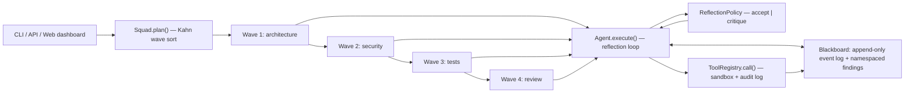

# agent-squad — Zero-Dependency Multi-Agent Orchestration with Self-Reflection

**Open Agent Hackathon 2026 (GenAI Works)** · autonomous agents / multi-agent collaboration

> **Zero dependencies. Python standard library only.** No LangChain, no CrewAI, no
> pip install treadmill. The entire framework — agent runtime, wave orchestrator,
> blackboard event bus, sandboxed tool registry, LLM providers, 5-dimension
> scoring rubric, state checkpointing, Raft consensus — is built **exclusively on
> `python3 -m pip install` nothing.** If you have Python 3.9+, you can run,
> audit, and extend every line of it.

Most multi-agent frameworks trade a 200-package dependency tree for a demo.
`agent-squad` proves the opposite: a production-shaped orchestration core
(~5,000 lines of stdlib Python, **76 passing tests**) that makes three things
*structural* instead of aspirational:

1. **Multi-agent wave orchestration** — specialised agents are grouped into
   dependency-declared waves; `Squad.plan()` topologically sorts the DAG
   (Kahn, stable tie-breaking) and runs each wave behind a thread barrier, so
   no agent can observe a same-wave sibling's in-flight state. Runs are
   reproducible by construction.
2. **Autonomous self-reflection** — no agent output leaves the agent until it
   passes a deterministic 5-dimension rubric. Failures return as a concrete,
   one-line critique and the draft is rewritten (up to `max_rounds`), with
   stagnation detection.
3. **Closed-loop tool execution** — the only way an agent can claim something
   about the world is by calling a sandboxed tool whose result is replayed
   into the next model turn. Every call is validated, workdir-confined,
   capped, and audit-logged.

The reference workload is the hackathon's code-quality audit squad:
**Architecture Reviewer → Security Sniffer → Test Engineer → Lead Auditor**.

## Quickstart (no credentials, no network, no installs)

```bash
git clone https://github.com/Alphaxiaoteng/genai-open-agent.git
cd genai-open-agent
PYTHONPATH=src python3 -m squad.cli demo      # audits a generated flawed sample package
PYTHONPATH=src python3 -m squad.cli audit ./path   # audits YOUR package (py/md by default)
PYTHONPATH=src python3 -m squad.cli demo --json    # machine-readable payload
```

With Docker — one command, nothing else needed:

```bash
docker build -t agent-squad . && docker run --rm agent-squad
```

Run the test suite (works with stdlib `unittest`; `pytest` optional):

```bash
PYTHONPATH=src python3 -m unittest discover -s tests -t .
# or:  pip install -e '.[dev]' && pytest        # → 76 passed
```

Expected demo result: `status: PASS`, every agent scoring ≥ 0.84 across all
five rubric dimensions.

## Architecture



| Layer | Module | What it does |
|---|---|---|
| Orchestration | `squad/squad.py` | dependency DAG → stable wave plan, thread-pool execution behind a barrier, event stream |
| Shared memory | `squad/memory.py` | `Blackboard`: append-only event log + namespaced findings, RLock-guarded, versioned revisions |
| Agent runtime | `squad/agent.py` | `Agent.execute()` reflection loop, `ReflectionPolicy`, `AgentResult` |
| Rubric critic | `squad/critic.py` | deterministic 5-dimension scorer + one-line critique generator |
| Tools | `squad/tools.py` | `ToolRegistry` with schema validation, workdir containment (`realpath` + `commonpath`), allowlists, timeouts, output caps, audit log |
| LLM | `squad/llm.py` | OpenAI-compatible client over `urllib`, deterministic `MockLLM`, `ProviderFallback` (auto → live → mock degradation) |
| Resilience | `squad/checkpoint.py` | state snapshots, time-travel rollback, token-budget circuit breaker |
| Consensus | `squad/raft.py` | Raft leader election + log replication for multi-node squads |
| Web (optional) | `squad/web_server.py`, `frontend/` | FastAPI dashboard + WebSocket live DAG (the *only* optional extras, not needed for the core) |

### Wave orchestration, not a task queue

Agents declare `depends_on` other groups; `plan()` emits a stable topological
ordering. Each wave executes in a thread pool behind a barrier, and
cross-agent data flow is explicit via `needs=(namespace,)` — an agent reads
only published, versioned blackboard namespaces, never a sibling's scratch
state. That is what makes runs reproducible.

### Blackboard event flow

Every agent turn appends structured events (draft, critique, tool call, tool
result, acceptance) to an append-only log. Findings live in per-agent
namespaces (`audit-architecture`, `audit-security`, …) with revision counters,
so downstream agents consume immutable snapshots while the publisher keeps
writing. In the demo you'll see 8 messages across 4 namespaces, each carrying
the scored output.

### The 5-dimension Rubric

Every draft is scored deterministically — no model call, no hand-waving:

| Dimension | Weight | Measurement |
|---|---|---|
| `structure` | 0.25 | fraction of the six required section headers present |
| `coverage` | 0.20 | fraction of task keywords (≥4 chars, deduped, first 12) present |
| `evidence` | 0.25 | distinct file paths cited + tool calls + `[tool ` observation markers |
| `specificity` | 0.15 | penalises vague wording, rewards backticked identifiers |
| `actionability` | 0.15 | imperative `- verb` bullets + fix-oriented verbs |

Acceptance requires `score ≥ 0.75`, every dimension `≥ 0.5`, and non-empty
output. A rejection emits a one-line critique naming the failing dimensions in
ascending score order plus a concrete instruction derived from the worst
dimension — injected into the next rewrite round.

### Closed-loop, sandboxed tools

`ToolRegistry.call()` never raises: unknown tool → `NOT_FOUND`, bad args →
`MISSING_ARGS`/`EXTRA_ARGS`/`BAD_TYPE`, gated tool → `DANGEROUS`, path escape
→ `PERMISSION`, hang → `TIMEOUT`. Filesystem tools are confined by workdir
containment; `python_exec` runs in a real subprocess with an allowlist and
metacharacter rejection. Every result is fed back as an observation into the
next model turn — agents can only cite what tools actually returned.

## Using a real model

The framework speaks the OpenAI-compatible `/chat/completions` protocol over
`urllib` — OpenAI, DashScope-compatible gateways, vLLM, Ollama's OpenAI shim:

```bash
export OMP_BASE_URL=https://api.openai.com/v1
export OMP_API_KEY=sk-...
export OMP_MODEL=gpt-4o-mini
PYTHONPATH=src python3 -m squad.cli audit ./src --live
```

| Variable | Default | Meaning |
|---|---|---|
| `OMP_BASE_URL` | `https://api.openai.com/v1` | endpoint root |
| `OMP_API_KEY` (or `OPENAI_API_KEY`) | — | bearer token |
| `OMP_MODEL` | `gpt-4o-mini` | model name |
| `OMP_LLM_MODE` | `auto` | `auto` \| `mock` \| `live` |

`auto` prefers the live provider and degrades mid-run through
`ProviderFallback` (records a warning, never crashes the run). With no
credentials, the deterministic `MockLLM` drives the full pipeline offline.

## Library use

```python
from squad.agent import Agent, ReflectionPolicy
from squad.squad import Squad
from squad.tools import build_default_registry

tools = build_default_registry(workdir="./workspace")

architect = Agent("architect", role="Architecture Reviewer", goal="map module boundaries",
                  tools=tools, policy=ReflectionPolicy(min_score=0.75, max_rounds=3))
sniffer = Agent("sniffer", role="Security Sniffer", goal="find injection sinks", tools=tools)

squad = Squad("audit", max_workers=4)
squad.add(architect, group="architecture")
squad.add(sniffer, group="security", depends_on=("architecture",), needs=(architect.write_namespace,))

result = squad.run(focus="audit ./workspace")
print(result.scores)          # {'architect': 0.87, 'sniffer': 0.81}
```

## Verification

Every claim above is exercised by the suite (`tests/` — **76 tests, all
passing**): real subprocess execution for `python_exec`, real filesystem
writes for `write_file`, real thread contention on the blackboard, Raft
consensus failover, checkpoint/rollback round-trips, and CLI invocations as
subprocesses for the end-to-end path. Reproducibility is asserted by
comparing score maps across repeated runs.

Full design and algorithm rationale: [`docs/ARCHITECTURE.md`](docs/ARCHITECTURE.md).
Frozen interfaces: [`docs/CONTRACT.md`](docs/CONTRACT.md).

## Repository layout

```text
src/squad/      # the zero-dependency core (~5,000 lines, stdlib only)
src/squads/     # reference squads: the 4-role code-audit squad + sample package
tests/          # 76 tests: concurrency, sandbox, rubric, raft, checkpoint, e2e CLI
examples/       # demo.py — the full 4-wave audit pipeline
docs/           # ARCHITECTURE.md, CONTRACT.md, QUICKSTART.md, DEMO_SCRIPT.md
frontend/       # optional web dashboard (FastAPI/WebSocket; not required for the core)
Dockerfile      # runs the offline demo with zero dependencies to install
```
